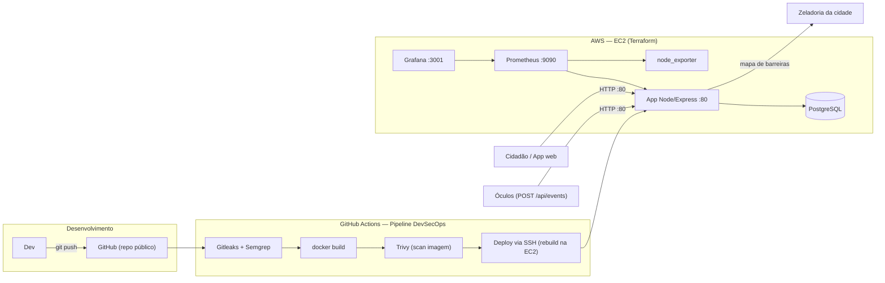

# Guiding Hand — Cloud & DevSecOps ("Deploy Blindado")

MVP em nuvem do **Guiding Hand**, projeto do desafio **CitizenTech** (FIAP · Global Solution 2026.2 · Engenharia de Software 4º ano · 4ES).

O Guiding Hand é um par de óculos inteligentes que ajuda pessoas cegas ou com baixa visão a andar pela cidade com mais segurança. Este repositório entrega a **fatia de Produção** do projeto (disciplina *Secure DevOps Tools & Cloud Computing*): o **aplicativo e os serviços na nuvem**, com **entrega automatizada (CI/CD)**, **verificação de segurança a cada mudança** e **monitoramento com alertas**.

---

## 👥 Integrantes


> João Rodrigo Solano Nogueira RM 551319 
> Julia Amorim Bezerra RM 99609 
> Lana Giulia Auada Leite  RM 551143
> Tony Willian da Silva Segalin RM 550667

---

## 🧾 Ficha Técnica do MVP

| Item | Descrição |
|---|---|
| **Produto** | Guiding Hand Cloud — API de eventos de obstáculos + mapa de barreiras + app web acessível |
| **Problema (CitizenTech)** | Pessoas cegas/baixa visão: a bengala não detecta obstáculos acima da cintura; usar o celular na rua expõe a furtos |
| **Nossa fatia** | Serviços em nuvem, pipeline DevSecOps e observabilidade |
| **Linguagem/Runtime** | Node.js 20 (Express) |
| **Banco de dados** | PostgreSQL 16 |
| **Container** | Docker (multi-stage, usuário não-root) + Docker Compose |
| **Nuvem / IaC** | AWS EC2 provisionada por Terraform |
| **CI/CD** | GitHub Actions (build, Gitleaks, Semgrep, Trivy, deploy automático) |
| **Observabilidade** | Prometheus + Grafana (4 métricas de ouro) + Alertas |
| **URL pública** | http://3.90.210.154 |

---

## 🏗️ Arquitetura



**Portas e exposição (Security Group do Terraform):**

| Porta | Serviço | Exposição |
|---|---|---|
| 80 | Aplicação (MVP público) | 🌍 `0.0.0.0/0` (pública) |
| 22 | SSH | 🔒 apenas o nosso IP |
| 9090 | Prometheus (admin) | 🔒 apenas o nosso IP |
| 3001 | Grafana (admin) | 🔒 apenas o nosso IP |
| 5432 | PostgreSQL | 🚫 não exposta (rede interna) |

> A porta de admin **nunca** é aberta para `0.0.0.0/0` — o Terraform inclusive bloqueia `admin_cidr = "0.0.0.0/0"`.

---

## 🧱 Endpoints da API

| Método | Rota | Descrição |
|---|---|---|
| `GET` | `/` | App web acessível (escolher destino, ver barreiras) |
| `POST` | `/api/events` | Óculos enviam um obstáculo detectado (`obstacle`, `lat`, `lng`) |
| `GET` | `/api/barriers?status=confirmed` | Mapa de barreiras consolidado |
| `GET` | `/api/route?from=&to=` | Rota simplificada sinalizando barreiras conhecidas |
| `GET` | `/health` | Liveness/readiness (checa o banco) |
| `GET` | `/metrics` | Métricas em formato Prometheus |

---

## ▶️ Rodando localmente (Docker Compose)

Pré-requisitos: Docker + Docker Compose.

```bash
cp .env.example .env    # edite as senhas
docker compose up -d --build
```

- App: <http://localhost> (porta 80)
- Grafana: <http://localhost:3001> (login do `.env`)
- Prometheus: <http://localhost:9090>

Teste rápido:

```bash
curl http://localhost/health
curl -X POST http://localhost/api/events -H "Content-Type: application/json" -d '{"obstacle":"placa","lat":-23.5505,"lng":-46.6333}'
curl http://localhost/api/barriers?status=all
```

---

## ☁️ Deploy na AWS (Terraform)

Pré-requisitos: conta AWS, AWS CLI configurado (`aws configure`), Terraform ≥ 1.5 e um **Key Pair** EC2 criado no console.

```bash
cd infra
cp terraform.tfvars.example terraform.tfvars   # preencha key_name, admin_cidr, repo_url
curl -s https://checkip.amazonaws.com           # descubra seu IP para o admin_cidr (/32)
terraform init
terraform plan
terraform apply
```

Ao final, o Terraform imprime `app_url`, `grafana_url` e `ssh_command`. O `user_data` instala Docker, clona este repositório e sobe a stack sozinho.

> **State e segredos:** `terraform.tfstate` e `*.tfvars` ficam **fora do repositório** (ver `.gitignore`). As senhas do banco e do Grafana são geradas **aleatoriamente na própria EC2** pelo `user_data` — nunca ficam no repo nem no state.

---

## 🔐 Pipeline DevSecOps (GitHub Actions)

A cada `push`/`pull_request` na `main` (`.github/workflows/ci-cd.yml`):

1. **Gitleaks** — procura segredos vazados no código e no histórico.
2. **Semgrep** — análise estática (SAST) de JS, segurança e Dockerfile.
3. **docker build** — constrói a imagem.
4. **Trivy** — barra a imagem se houver vulnerabilidades `HIGH`/`CRITICAL` (porta de qualidade: só passa para o deploy se não houver).
5. **Deploy** automático via SSH na EC2 (só em push na `main`): `git pull` + `docker compose up -d --build`, reconstruindo a partir do commit já escaneado.

**Secrets necessários** (repositório → *Settings → Secrets and variables → Actions*):

| Secret | Para quê |
|---|---|
| `EC2_HOST` | IP público da EC2 |
| `EC2_SSH_KEY` | Chave privada SSH (conteúdo do `.pem`) |

### Evidência exigida: execução barrada ✗ e corrigida ✓

Para demonstrar o pipeline barrando um problema (ver `docs/RELATORIO.md`):

- **Segredo (Gitleaks):** faça um commit com uma chave fake (ex.: `AWS_SECRET_ACCESS_KEY=AKIA...`) → pipeline **falha**. Remova o segredo → pipeline **passa**.
- **Vulnerabilidade (Trivy/Semgrep):** troque a base para uma imagem antiga (ex.: `node:18.0-alpine`) ou escreva uma query SQL concatenada → **falha**. Volte para `node:20-alpine` / query parametrizada → **passa**.

Tire print das duas execuções (vermelha e verde) para o PDF.

---

## 📊 Observabilidade — 4 Métricas de Ouro

Dashboard provisionado automaticamente no Grafana (*Guiding Hand — 4 Métricas de Ouro*):

| Métrica de ouro | Como é medida |
|---|---|
| **Latência** | `http_request_duration_seconds` (p95 e p50) |
| **Tráfego** | `rate(http_requests_total)` por rota |
| **Erros** | % de respostas `5xx` |
| **Saturação** | CPU e memória do host (node_exporter) |

**Alertas** (`monitoring/alert.rules.yml`): `HighErrorRate`, `HighRequestLatencyP95`, `AppDown`.

### Como disparar um alerta (para o print)

```bash
docker compose stop db        # derruba o banco
curl -X POST http://localhost/api/events -H "Content-Type: application/json" -d '{"obstacle":"placa","lat":-23.5,"lng":-46.6}'
# repita algumas vezes → a API responde 500 → após 1 min o alerta HighErrorRate dispara
```

Veja em Prometheus → *Alerts* (estado **FIRING**) ou no painel do Grafana. Depois: `docker compose start db`.

---

## 🛡️ LGPD — onde ficam os dados pessoais

O uso do produto **revela uma deficiência**, então é tratado como **dado pessoal sensível** (LGPD, art. 5º, II). Princípios aplicados:

- **Mínimo de dados:** guardamos apenas o **tipo do obstáculo** e uma **posição aproximada** (lat/lng arredondadas a 4 casas, ~11 m). Nunca o trajeto exato nem identificação do usuário.
- **Sem imagens:** as imagens da câmera dos óculos são processadas e **descartadas na hora** (fora do escopo cloud); a nuvem só recebe o resultado (tipo + posição aproximada).
- **Onde os dados residem:** tabela `events`/`barriers` no PostgreSQL, em volume **EBS criptografado** (gp3), dentro da EC2. Banco **não exposto** à internet.
- **Em trânsito:** recomenda-se TLS (HTTPS) em produção — ver "Próximos passos".
- **Anonimização:** os registros não contêm identificador de pessoa; são eventos anônimos que alimentam o mapa de barreiras público.

---

## 🤝 Responsabilidade compartilhada (AWS)

| Camada | Responsável |
|---|---|
| Infra física, rede, hipervisor, data centers | **AWS** (segurança *da* nuvem) |
| Sistema operacional, patches, Docker | **Nós** (via `user_data`/manutenção) |
| Security Group, portas, IAM, IMDSv2 | **Nós** |
| Aplicação, dependências, código | **Nós** (Semgrep/Trivy no CI) |
| Dados e segredos (senhas, chaves) | **Nós** (GitHub Secrets, `.env` fora do repo) |

---

## 💰 Estimativa de custo (AWS us-east-1)

| Recurso | Dentro do Free Tier (12 meses) | Depois do Free Tier |
|---|---|---|
| EC2 `t3.micro` (750 h/mês) | **US$ 0** | ~US$ 7,50/mês |
| EBS gp3 20 GB | **US$ 0** (até 30 GB) | ~US$ 1,60/mês |
| Transferência de dados | **US$ 0** (100 GB/mês grátis) | ~US$ 0 |
| **Total aproximado** | **≈ US$ 0/mês** | **≈ US$ 9–10/mês** |

> GitHub Actions e Grafana/Prometheus (self-hosted na EC2) são gratuitos para repositório público. Lembre de `terraform destroy` ao final para não gerar custo.

---

## 🚀 Próximos passos (fora do escopo da entrega)

- HTTPS/TLS com domínio + certificado (ex.: Caddy/Nginx + Let's Encrypt).
- Backend remoto de state (S3 + DynamoDB lock).
- v2: reconhecimento de obstáculos rodando no próprio óculos (sem enviar imagem à nuvem).

---

## 📁 Estrutura do repositório

```
.
├── app/                     # Aplicação Node/Express
│   ├── src/                 # server, rotas, métricas, db
│   ├── public/              # front web acessível
│   ├── db/init.sql          # schema (dado mínimo p/ LGPD)
│   └── Dockerfile           # multi-stage, não-root
├── infra/                   # Terraform (AWS EC2 + Security Group)
├── monitoring/              # Prometheus + regras de alerta + Grafana
├── .github/workflows/       # Pipeline CI/CD DevSecOps
├── docker-compose.yml       # Stack completa
└── docs/RELATORIO.md        # Esqueleto do PDF de entrega
```
